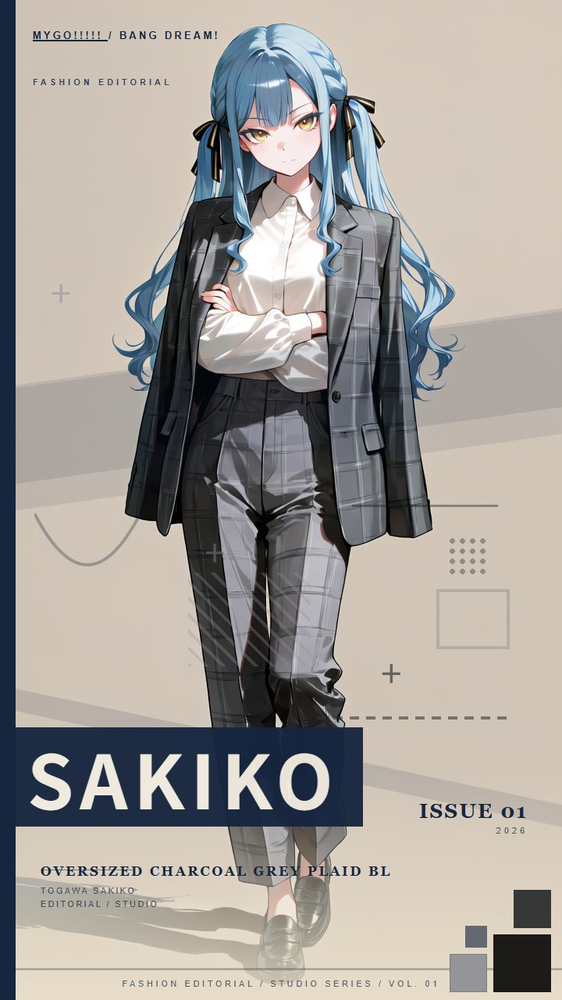

# 杂志海报 01（Magazine Poster 01）

**一句话**：把角色拍成**时尚杂志的编辑大片** —— 纯米色背景、柔和光、大量留白；出完图再叠上杂志文字，就是一张封面。

*上面这张就是完整跑出来的效果：出图 + 叠字。*

**包里只讲提示词怎么写**，不涉及插件、LoRA 或工作流 —— 用你自己的工具照做就行。

## 包里有什么

| 文件 | 内容 |
|---|---|
| `references/01-提示词骨架.md` | 三段固定文本 + 变量段 —— **风格的核心，先读这份** |
| `references/02-参数与坑.md` | 画幅 / 质量前缀 / 负面 / 角色 tag / 六个必读的坑 |
| `references/03-排版与交付.md` | 配套排版工具怎么用 |
| `assets/示例-SAKIKO.jpg` | 完整效果示例（出图 + 叠字） |
| `MagazineCaptionStudio.zip` | 排版工具本体，解压后双击 `启动.bat` 即用 |

## 快速上手（三步）

1. **读** `references/01-提示词骨架.md` —— 先搞清那三段固定文本，它们是风格的命根子
2. **照** `references/02-参数与坑.md` 拼提示词出图
3. **排版**：解压 `MagazineCaptionStudio.zip` → 双击 `启动.bat` → 上传图 → 叠字 → 下载

## ⚠️ 三条最容易翻车的

1. **背景段一字不能改** —— 改了米色底子就没了，后面叠字会糊成一片
2. **负面提示词里不能出现 `text`** —— 有的话模型会回避文字区域，叠字时那块底色会脏
3. **服装描述要写具体** —— 写模糊了模型会画回角色的默认服装

## 你需要自己准备

- **一个能出动漫图的模型**（这套按 Anima 系调的，别的模型也能用，质量前缀可能要换）
- **你自己的出图工具**（本包不含工作流）
- **Python 3 + Pillow** —— 只在用**命令行版**排版时需要；网页版不需要

## 两份文档怎么分工

- 只想**出图**（不排版）→ 读 `01` + `02`
- 只想**排版**（已有图）→ 直接读 `03`
- **封面取景变体**（半身、头顶留空，适合大标题压在人物身上）→ 见 `02` 的「取景变体」
